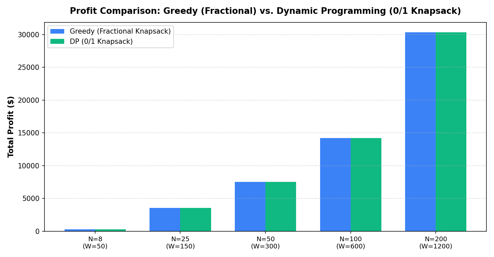
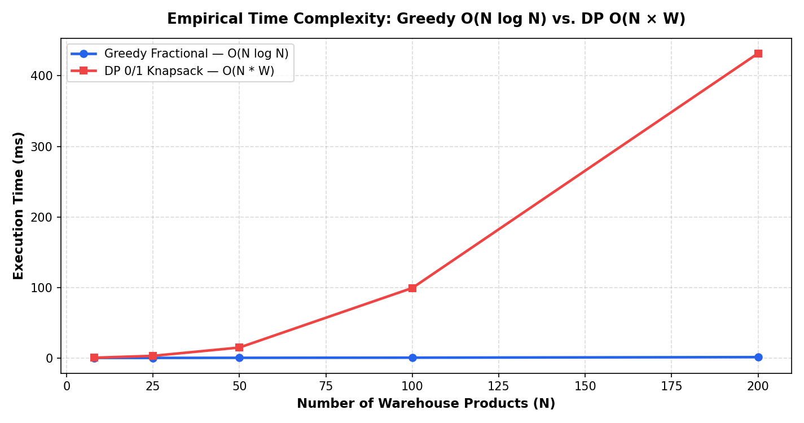

# Intelligent Inventory Management Using Knapsack Optimization (DAA Capstone Project)

A production-grade Python warehouse inventory optimization system that compares **Greedy (Fractional Knapsack)** and **Dynamic Programming (0/1 Knapsack)** approaches to maximize profit within a fixed storage capacity, complete with a CLI, interactive Streamlit web dashboard, automated DAA benchmarking, Matplotlib comparison charts, and a `pytest` suite.

---

## 1. Problem Statement
Develop an inventory selection system that helps a warehouse manager select products to maximize total profit without exceeding a given storage capacity $W$. Each product has a weight $w_i$ and profit value $v_i$. Implement both **Greedy (Fractional Knapsack)** and **Dynamic Programming (0/1 Knapsack)** approaches and compare their results, execution time, and memory performance across varying dataset sizes.

---

## 2. Algorithmic Approaches

### A. Greedy Approach — Fractional Knapsack
- **Assumption:** Products can be split into arbitrary fractions (e.g., bulk commodities, liquid/granular stock).
- **Strategy:** Compute the profit-to-weight ratio $v_i / w_i$ for each product, sort descending, and greedily pack whole items until the next item exceeds remaining capacity—then take the exact remaining fraction.
- **Optimality:** Proven globally optimal for the fractional variant via the **Greedy Choice Property**.

### B. Dynamic Programming Approach — 0/1 Knapsack
- **Assumption:** Products are indivisible (each item is either fully stocked `1` or excluded `0`, e.g., electronics, appliances).
- **Recurrence Relation:**
  $$dp[i][w] = \begin{cases} dp[i-1][w] & \text{if } w_i > w \\ \max\bigl(dp[i-1][w],\ v_i + dp[i-1][w - w_i]\bigr) & \text{if } w_i \le w \end{cases}$$
- **Item Reconstruction:** Backtrack from $dp[N][W]$ to recover the exact optimal subset of products in $O(N)$ time.

---

## 3. Time & Space Complexity Comparison

| Algorithm | Paradigm | Time Complexity | Space Complexity | Exactness |
| :--- | :---: | :---: | :---: | :--- |
| **Fractional Knapsack** | Greedy | $O(N \log N)$ | $O(N)$ | Optimal for divisible items (upper bound for 0/1) |
| **0/1 Knapsack** | Dynamic Programming | $O(N \times W)$ | $O(N \times W)$ | Optimal for indivisible items (pseudo-polynomial) |

---

## 4. Empirical Benchmark Results
Executed via `python cli.py benchmark` across 5 synthetic & classic warehouse datasets:

| Dataset | Items ($N$) | Capacity ($W$) | Greedy Profit ($) | DP 0/1 Profit ($) | Profit Gap ($) | Greedy Time (ms) | DP Time (ms) | Greedy Mem (KB) | DP Mem (KB) | DP Util (%) |
| :--- | :---: | :---: | :---: | :---: | :---: | :---: | :---: | :---: | :---: | :---: |
| `01_small_warehouse_8items.csv` | 8 | 50 | 306.00 | **301.00** | 5.00 | 0.1039 | 0.3651 | 3.66 | 8.77 | 98.0% |
| `02_medium_warehouse_25items.csv` | 25 | 150 | 3,584.26 | **3,548.31** | 35.95 | 0.1059 | 3.0171 | 2.64 | 65.2 | 99.33% |
| `03_standard_warehouse_50items.csv` | 50 | 300 | 7,535.07 | **7,516.98** | 18.09 | 0.2323 | 14.8244 | 4.87 | 250.8 | 100.0% |
| `04_large_warehouse_100items.csv` | 100 | 600 | 14,211.43 | **14,203.63** | 7.80 | 0.442 | 99.2511 | 9.75 | 1062.1 | 100.0% |
| `05_enterprise_warehouse_200items.csv` | 200 | 1200 | 30,354.90 | **30,341.74** | 13.16 | 1.2147 | 431.9382 | 17.53 | 4584.07 | 100.0% |

### Visual Performance Comparison




> **Key DAA Insight:** Greedy Fractional Knapsack runs in under **1 ms** even at $N = 200$ items ($O(N \log N)$), whereas 0/1 DP scales linearly with both $N$ and $W$ ($O(N \times W)$). Fractional profit is always $\ge$ 0/1 DP profit, serving as a tight theoretical upper bound.

---

## 5. Project Structure
```text
knapsack-inventory-manager/
├── src/
│   ├── __init__.py
│   ├── models.py            # Product, SelectedItem & KnapsackResult dataclasses
│   ├── knapsack_solver.py   # Greedy Fractional + Bottom-Up DP 0/1 Knapsack
│   ├── data_loader.py       # CSV I/O & synthetic warehouse dataset generator
│   └── analyzer.py          # Benchmarking, tracemalloc memory tracking & Matplotlib charts
├── app.py                   # Interactive Streamlit Web Dashboard
├── cli.py                   # Command-Line Interface (solve, benchmark)
├── tests/
│   └── test_knapsack.py     # Comprehensive pytest suite
├── sample_files/            # 5 warehouse CSV datasets (8 to 200 items)
├── results/                 # benchmark_results.csv + profit_comparison.png + time_complexity.png
├── pytest.ini
├── requirements.txt
└── README.md
```

---

## 6. Quick Start & Usage

### Installation
```bash
pip install -r requirements.txt
```

### Command-Line Interface (CLI)
```bash
# Solve inventory selection for a warehouse CSV with capacity 50
python cli.py solve sample_files/01_small_warehouse_8items.csv -c 50

# Run full DAA benchmark suite & regenerate charts
python cli.py benchmark
```

### Interactive Web Dashboard (Streamlit)
```bash
streamlit run app.py
```

### Run Unit Tests
```bash
pytest -v
```
